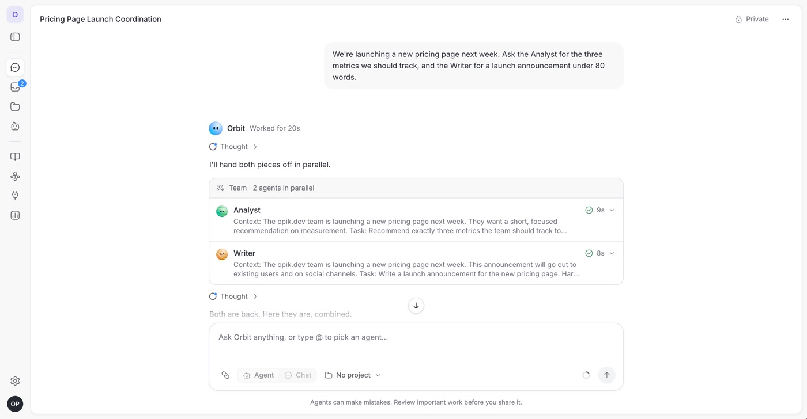
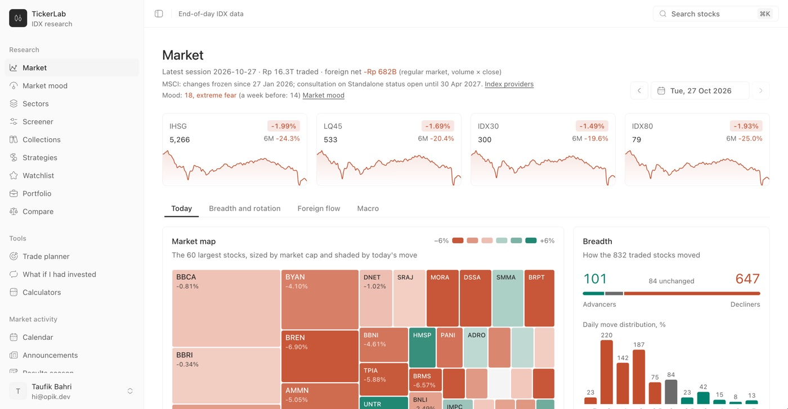
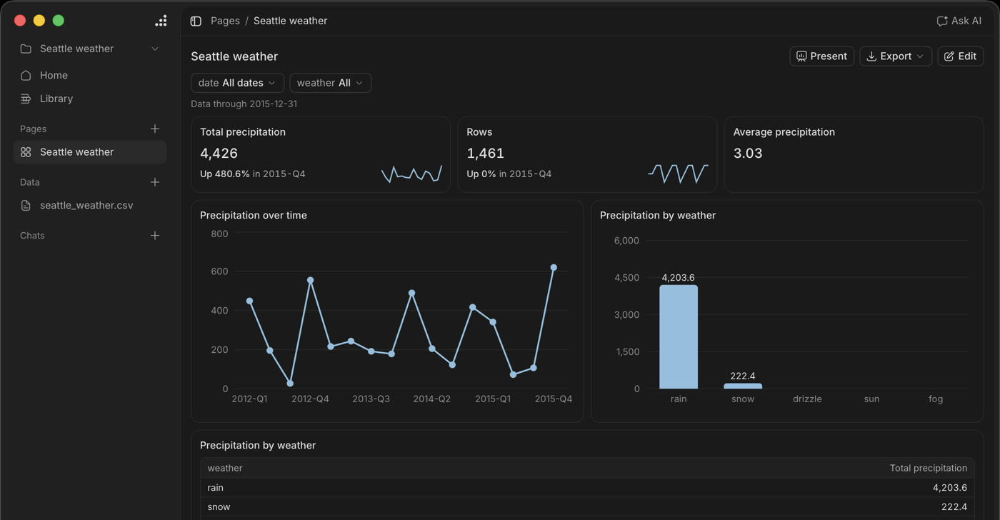

Taufik Bahri, or Opik to most people. I'm an AI product engineer in Bogor, Indonesia, and I build AI products end to end, from the interface to the agents behind it. Thirteen years shipping for the web, nine of them leading frontend teams.

### Products

<table>
  <tr>
    <td width="33%" valign="top">
      
       <b><a href="https://opik.dev/work/orbit/">Orbit</a></b>
       AI agent platform for teams, specced and built in 17 days
       Case study · in testing
    </td>
    <td width="33%" valign="top">
      
       <b><a href="https://opik.dev/work/tickerlab/">TickerLab</a></b>
       Indonesian stock research, with strategies tested on unseen data
       Live · free · <a href="https://tickerlab.opik.dev">open it</a>
    </td>
    <td width="33%" valign="top">
      
       <b><a href="https://github.com/opikdev/davis">Davis</a></b>
       Local data workspace: ask questions, chart the answers
       Open source · desktop app
    </td>
  </tr>
</table>

**In progress:** [Taffrail](https://github.com/opikdev/taffrail), a Kubernetes desktop console built around live logs across many pods, in Rust.

### Developer tools

Open source tools for starting and running projects with coding agents.

| Project | What it does | Get it |
|---|---|---|
| [pik](https://github.com/opikdev/pik) | Creates projects from agent-ready starter templates | `brew install opikdev/tap/pik` |
| [starters](https://github.com/opikdev/starters) | The templates: Hono and Go APIs, MCP servers in TypeScript and Python | `pik list` |
| [skills](https://github.com/opikdev/skills) | Standards for agents: code, backend, UI, docs, git, reviews | `npx skills add opikdev/skills` |
| [agent-harness](https://github.com/opikdev/agent-harness) | Project map, skills and enforced checks for an existing repo | `pik add agent-harness` |

pik creating a project from a starter. A real recording, made with <a href="assets/pik.tape">this VHS script</a>.

### Recently shipped

<!-- releases:start -->
- [pik v0.4.0](https://github.com/opikdev/pik/releases/tag/v0.4.0) · Nov 9, 2026
- [davis v0.2.1](https://github.com/opikdev/davis/releases/tag/v0.2.1) · Nov 8, 2026
- [starters v0.1.1](https://github.com/opikdev/starters/releases/tag/v0.1.1) · Nov 8, 2026
<!-- releases:end -->

Open to AI product engineer and senior full-stack roles, full-time or contract, remote (UTC+7).

[opik.dev](https://opik.dev) · [LinkedIn](https://www.linkedin.com/in/taufik-bahri) · hi@opik.dev
